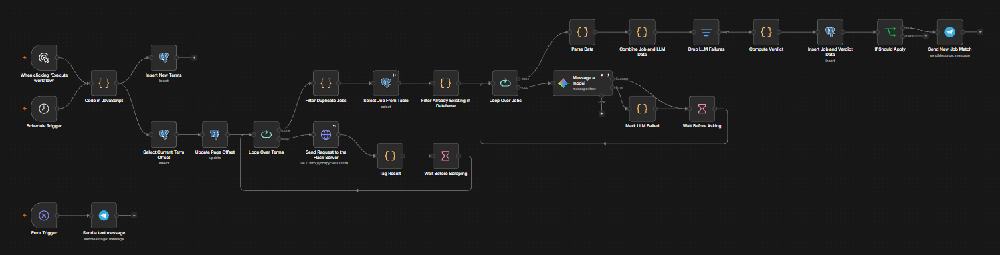
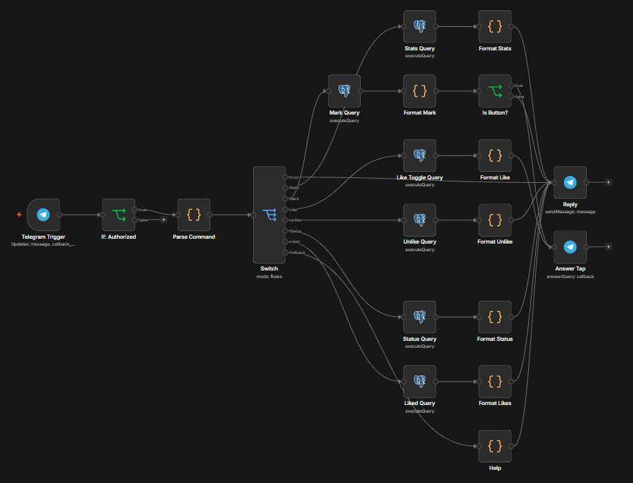

# Job Hunter

An automated job discovery pipeline that scrapes backend/fullstack listings from Indeed and LinkedIn, has an LLM judge each one against a personal fit profile, applies deterministic rules in code to decide what's worth my time, and notifies me on Telegram. A companion Telegram bot tracks what I do with each alert.

Built to solve a real constraint: I'm a backend developer with a Return of Service (ROS) obligation to DOST-SEI, which means my employer must be a Philippine-registered entity. Most job boards don't let you filter for that, so I built a pipeline that does.

## What it does

Every run, the pipeline:

1. Pulls a rotating set of search terms, each with its own result offset, so repeated runs surface new listings instead of re-scraping the same top results
2. Scrapes Indeed and LinkedIn via [JobSpy](https://github.com/speedyapply/JobSpy) through a small Flask wrapper
3. Tags every result with the search term that found it, deduplicates within the batch (merging terms when several found the same job), and skips anything already stored in Postgres
4. Sends each new job to an LLM, which returns **judgments only**: employer ROS status, work setup, office days, whether the office is in range, whether it's a development role, and three subscores
5. Runs those judgments through a **Compute Verdict** code node that owns every rule: dates, thresholds, salary math, gates, flags, and the final apply decision
6. Stores every evaluated job, pass or fail, with the judgments, the computed verdict, and the rules version that produced it
7. Sends a Telegram alert with ❤️ / ✅ / 🔗 buttons only for jobs that pass every gate and score 5+ out of 10

Runs four times a day (8 AM, 12 PM, 4 PM, 8 PM Asia/Manila) on an always-on homelab server (a Lenovo M710Q). No application automation: this surfaces candidates for me to review and apply to myself.

## Why this exists

ROS compliance is a hard filter that's basically invisible to standard job board search. "Remote" doesn't tell you whether the company has a Philippine entity that can issue a Certificate of Employment. Reading every listing manually to check this, on top of stack fit, work setup, and experience level, was the actual bottleneck in my job search. This automates the screening, not the applying.

The same shape (ingest leads, enrich them with an LLM, qualify them with explicit rules, route the good ones to a human with one-tap actions) is a lead-qualification engine; here the "leads" are job postings.

## Architecture

Two workflows, one per trigger: a scheduled **pipeline** and an event-driven **bot**.




### Pipeline ([`n8n/job-hunter-workflow.json`](./n8n/job-hunter-workflow.json))

1. **Schedule Trigger** → **Code** generates the search terms as items
2. Terms flow to **Insert New Terms** (seeds `job_hunter.search_offsets` for new terms) and **Select Current Term Offset** → **Update Page Offset** (reads and advances each term's offset)
3. **Loop Over Terms** → **Send Request to the Flask Server** → **Tag Search Term** (attaches the term to every job via n8n's paired-item link back to the loop)
4. **Filter Duplicate Jobs** dedupes by `job_id` within the batch, merging `search_terms` so a job found by three terms records all three
5. **Select Job From Table** + **Filter Already Existing in Database** drop jobs evaluated in earlier runs
6. **Loop Over Jobs** (batch size 1) → **Message a model** (Gemini, up to 5 tries) → **Wait Before Asking** (rate-limit buffer). If all tries fail, the error output goes to **Mark LLM Failed**, which returns a placeholder into the same loop
7. **Parse Data** (also marks unparseable LLM output as failed) → **Combine Job and LLM Data** → **Drop LLM Failures** → **Compute Verdict** → **Insert Job and Verdict Data**
8. **If Should Apply** (`llm_apply`) → **Send New Job Match** (Telegram, with inline buttons)

The workflow is its own error workflow: if any run fails, an **Error Trigger** sends a separate 🔴 Telegram message, so a crash never looks like a quiet job market.

### Bot ([`n8n/job-hunter-bot.json`](./n8n/job-hunter-bot.json))

1. **Telegram Trigger** (messages and button taps)
2. **If: Authorized** checks the sender's Telegram ID against mine; the false branch is deliberately unconnected, so strangers get no response at all
3. **Parse Command** normalizes both typed commands and button payloads into one shape: `{kind, ids, word, chat_id, error, text, route}`, with validation
4. **Switch** on the single `route` string → one Postgres query per action → a toast (for taps) or a reply message (for commands)

## Scoring design

### The LLM judges, code decides

Early versions let the LLM do everything: date math, salary thresholds, gating, flags. It was unreliable in exactly the places code is reliable: it miscounted days near the age cutoff, emitted contradictory flags (a "reach role" flag on a job it had scored as junior-friendly), and invented flags that weren't supported by the text.

Now the LLM returns **required fields** (true/false/null or enums, never optional flags, which it tended to skip) and the **Compute Verdict** node applies every rule. Anything that's a fact (whether "NestJS" appears in the text, how old the post is, whether ₱38k is above the floor) is computed in code. Anything that needs reading comprehension (is this a .NET shop, is this really a QA role, how many office days does "MW onsite, TThF WFH" mean) is the LLM's job.

### Gates

A gate zeroes the total score but **keeps the subscores**, so near-misses stay visible for tuning.

| Gate             | Rule                                                                                                                                |
| ---------------- | ----------------------------------------------------------------------------------------------------------------------------------- |
| `OLD JOB POST`   | Posted more than 31 days ago                                                                                                        |
| `ONSITE`         | Office every working day                                                                                                            |
| `OFFICE 3+ DAYS` | Hybrid with more than 2 required office days                                                                                        |
| `LOCATION FAR`   | Office clearly outside ~100km of Santa Cruz, Laguna                                                                                 |
| `STACK MISMATCH` | An out-of-ecosystem stack (Java enterprise, .NET, SAP, low-code platforms, legacy desktop, mobile-only) is the role's primary stack |
| `NOT DEV ROLE`   | The main job is QA, IT support, site administration, social media, data entry, or a student program                                 |

Unclear or missing inputs **never gate**: an unstated work setup becomes `SETUP UNCLEAR`, a missing date becomes `DATE UNKNOWN`, and the job still gets through. A noisy alert costs a few seconds; a wrongly gated job is invisible forever.

### Subscores (0–10)

- **Stack fit (0–3), LLM:** a closed list of out-of-ecosystem stacks scores 0 only when that stack is _primary_ (in the title, or the main build platform). "Nice to have" mentions don't count.
- **Experience (0–2), LLM:** junior/1–2 years scores 2; more than 3 years scores 0 and code adds `REACH ROLE`.
- **Green/red flags (0–3), LLM:** employer signals such as PH address, named EOR, junior-friendly language, time tracking, anonymous employer.
- **Salary (0–2), code:** JobSpy's structured salary first, the LLM's stated figure as fallback, always the bottom of any range, converted to monthly PHP and scored against two floors.

### ROS as a soft gate

A job whose employer clearly isn't PH-registered only alerts if its pay is high enough to make buying out the obligation worth considering (`ROS BUYOUT`). Unverifiable employers alert with a ⚠️ marker rather than being dropped.

`llm_apply = !gated && score >= 5 && (ros_status !== 'fail' || buyout)`

### Code-owned flags and rule versions

Every rule-based flag is listed in `CODE_FLAGS`; any copy the LLM emits is discarded and recomputed. **Every gate is also a code-owned flag**, so the LLM can't trigger a gate by inventing a flag. The only flags the LLM may set are descriptive: `NIGHT SHIFT` and `CONTRACT ROLE`.

Each row stores `rules_version`, so a rule change never mixes old and new scoring in the same analysis, and invariant checks only cover rows scored under the current rules:

```sql
-- must return 0 (first confirm rows exist for this version)
SELECT count(*) FROM job_hunter.jobs
WHERE rules_version = 6
  AND llm_score <> CASE
    WHEN llm_flags && ARRAY['OLD JOB POST','LOCATION FAR','ONSITE','OFFICE 3+ DAYS',
                            'STACK MISMATCH','NOT DEV ROLE']::text[] THEN 0
    ELSE score_stack + score_experience + score_flags + score_salary
  END;
```

## Bot commands

| Command / button         | What it does                                                                                                                         |
| ------------------------ | ------------------------------------------------------------------------------------------------------------------------------------ |
| ❤️ on an alert           | Toggles "interested" in one atomic statement: like, unlike, or no-op if the job has already moved further along                      |
| ✅ on an alert           | Marks the job as applied                                                                                                             |
| 🔗 on an alert           | Opens the listing                                                                                                                    |
| `/stats`                 | Jobs scored and alerted in the last 7 days, plus counts per application status                                                       |
| `/liked`                 | Jobs marked interested                                                                                                               |
| `/applied <ids>`         | Marks jobs applied. **Forward-only:** only moves jobs from interested/applied, so a typo can't rewind an interview back to "applied" |
| `/status <ids> <status>` | Explicit override; can set any status                                                                                                |
| `/unlike <ids>`          | Removes a job only while it's still just "interested"                                                                                |

Applications older than 21 days with no update are reported as **ghosted** by the `application_status` view. That's computed at read time, not stored, so it never goes stale.

## Key design decisions

**Offset rotation instead of a fixed scrape.** Job boards sort by relevance/recency, so scraping the same term every run mostly re-finds what was already seen. `search_offsets` tracks the offset per term and cycles 0 → 10 → 20 → 30 → 0.

**Search-term attribution as an array, not a single value.** Overlapping terms find the same jobs; keeping only the first term would credit whichever term runs first. Storing every term lets me measure which terms actually contribute alerts no other term finds, before cutting or adding any.

**Never trust the job board's remote flag.** Indeed marks "Hybrid remote" listings as remote; one caused a false alert for a 4-days-onsite role. Work setup comes only from the LLM reading the description.

**Every bot query returns exactly one row.** An n8n Postgres node that returns zero rows outputs nothing, and the flow silently stops. Queries aggregate with `json_agg`/`array_agg` + `coalesce` so there's always a row to format, and every formatter falls back to a non-empty message, since Telegram rejects empty ones.

**Route on one computed string.** The bot's Switch matches a `route` field built in Parse Command, using string equality only. Boolean rules in the Switch node caused type errors and false matches.

**Failures alert separately from successes.** The Error Trigger path sends its own message, distinct from "no good jobs this run."

**One failed LLM call skips one job, not the whole run.** Gemini's free tier returns occasional `503 ServiceUnavailable` errors when the model is overloaded, unrelated to quota. Originally a single 503 that outlasted the retries stopped the execution, and because inserts happen after the loop, every job already scored in that run was lost. Now a failed job produces a placeholder instead of an error: Combine pairs verdicts with jobs by position, so every loop iteration must emit exactly one item, or later verdicts would silently attach to the wrong listings. Placeholders are dropped after Combine and never inserted, and since cross-run dedup only skips jobs that are stored, a skipped job is evaluated again the next time a scrape finds it. Not inserting it _is_ the retry.

**Pinned test data can mask missing wiring.** Early on, a disconnected node's pinned output made every test run "work"; the first scheduled run failed because the real trigger output had no `term` field. Unpin and re-test from a cold trigger before trusting a workflow. For testing a single Code node, a scratch workflow (Manual Trigger → Code with pasted items → copy of the node) is faster and doesn't re-run upstream nodes.

**Adding a column means remapping the Insert.** n8n's manual column mapping silently drops fields it doesn't know about. Every `ALTER TABLE` is followed by refreshing the Insert node's columns and mapping the new field.

**LLM provider chosen for free-tier headroom.** Earlier Gemini Flash versions and Groq's `llama-3.1-8b-instant` hit free-tier limits (as low as 5 requests/day, or 6,000 TPM) on a multi-run-per-day schedule. **Gemini 3.1 Flash Lite** (15 RPM / 250K TPM / 500 RPD) plus a batch-size-1 loop with a short Wait stays under the per-minute ceiling.

## Tech stack

- **Orchestration:** [n8n](https://n8n.io/), self-hosted
- **Scraping:** Python, [JobSpy](https://github.com/speedyapply/JobSpy), Flask
- **Database:** PostgreSQL (separate `job_hunter` schema, isolated from n8n's internal tables)
- **LLM:** Google Gemini 3.1 Flash Lite (free tier)
- **Notifications and tracking:** Telegram Bot API
- **Infra:** Docker Compose on a Lenovo M710Q homelab server; the scraper joins the n8n stack's Docker network and publishes no ports. Tailscale Funnel exposes only n8n's webhook paths publicly (for the Telegram bot); the n8n editor stays reachable only inside the tailnet.

## Database schema

Everything lives in the `job_hunter` schema:

- **`jobs`**: every scraped job, including the LLM's judgments (`ros_status`, `work_setup`, subscores, `llm_reason`, `llm_flags`), code-computed fields (`llm_score`, `llm_apply`, `salary_monthly_php`, `salary_source`, `rules_version`), and `search_terms`
- **`search_offsets`**: current scrape offset per search term
- **`applications`**: one row per job I've acted on, with status, timestamps, and a note. References `jobs.id` with `ON DELETE RESTRICT`, so a tracked job can't be deleted by accident
- **`application_status`** (view): adds `effective_status`, which turns stale "applied" rows into "ghosted"

[`db/schema.sql`](./db/schema.sql) is generated from the live database with `pg_dump --schema-only`, and checked by loading it into a throwaway Postgres container, so it can't drift from what's actually running.

## Setup

### Homelab (existing n8n instance), how I run it

1. Clone the repo on the server and copy `.env.example` to `.env`. Set `N8N_NETWORK` to the Docker network your n8n container is on (`docker network ls`)
2. `docker compose -f docker-compose.homelab.yaml up -d --build` builds the Flask scraper and attaches it to that network, so n8n reaches it at `http://jobspy:5000`
3. Run [`db/schema.sql`](./db/schema.sql) against the Postgres instance n8n writes to
4. In n8n, import both workflows from [`n8n/`](./n8n/) and create the Postgres, Gemini, and Telegram credentials (they aren't stored in the exported JSON)
5. In the bot workflow, set the authorized Telegram user ID in the **If: Authorized** node
6. The bot's Telegram Trigger needs n8n reachable over public HTTPS: set `WEBHOOK_URL` to your public URL. Expose only the webhook paths, not the editor
7. Run the pipeline once manually to seed `search_offsets`, then activate both workflows

### Standalone (everything in one stack)

1. Clone the repo and copy `.env.example` to `.env`, filling in Postgres credentials and the n8n encryption key
2. `docker compose up -d` starts Postgres, the Flask scraper, and n8n
3. Open n8n at `http://localhost:5678`, import the workflows, and create the credentials
4. Run once manually to seed `search_offsets`, then activate. The bot still needs a public HTTPS `WEBHOOK_URL` to receive Telegram updates

## Results so far

An early representative run: 105 jobs scraped across 6 search terms and 2 sites → 81 after within-batch dedup → 60 after cross-run dedup → 12 alerts.

Moving the rules into code made the alerts much stricter and much cleaner. Recent runs typically produce a handful of alerts, nearly all real development roles within commuting range or remote. The most common rejections are accurate: the junior NestJS market in the Philippines is thin, and most matching listings ask for 3–6+ years, which the pipeline marks as a reach rather than a match.
