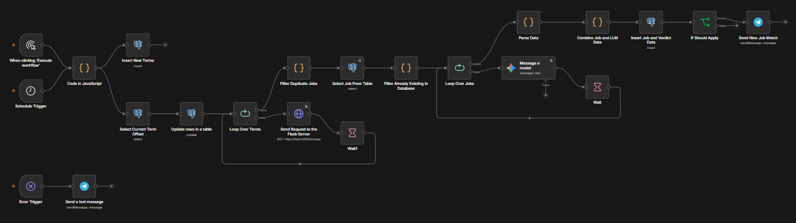

# Job Hunter

An automated job discovery pipeline that scrapes backend/fullstack listings from Indeed and LinkedIn, evaluates each one against a personal fit profile using an LLM, and notifies me on Telegram when something is worth applying to.

Built to solve a real constraint: I'm a backend developer with a Return of Service (ROS) obligation to DOST-SEI, which means my employer must be a Philippine-registered entity. Most job boards don't let you filter for that, so I built a pipeline that does.

## What it does

Every run, the pipeline:

1. Pulls a rotating set of search terms, each with its own result offset, so repeated runs surface new listings instead of re-scraping the same top results
2. Scrapes Indeed and LinkedIn via [JobSpy](https://github.com/speedyapply/JobSpy) through a small Flask wrapper
3. Deduplicates within the batch (same job appearing under multiple search terms) and against everything already stored in Postgres
4. Sends each genuinely new job to an LLM with a detailed prompt describing my background, ROS rules, stack preferences, and a weighted scoring rubric
5. Stores every evaluated job — pass or fail — in Postgres with the full verdict, score, and reasoning
6. Sends a Telegram notification only for jobs that pass ROS compliance and score 5+ out of 10

Runs four times a day — 8 AM, 12 PM, 4 PM, and 8 PM (Asia/Manila) — on an always-on homelab server (a Lenovo M700q), so it no longer depends on my laptop being awake. No application automation — this surfaces candidates for me to review and apply to myself.

## Why this exists

ROS compliance is a hard, non-negotiable filter that's basically invisible to standard job board search — "remote" doesn't tell you whether the company has a Philippine entity that can issue a Certificate of Employment. Reading every listing manually to check this, on top of stack fit and experience level, was the actual bottleneck in my job search. This automates the screening, not the applying.

## Architecture

**Flow summary:**

1. **Schedule Trigger** (or manual trigger for testing) → **Code in JavaScript** generates the current set of search terms as items
2. Those terms flow two ways in parallel: into **Insert New Terms** (seeds `job_hunter.search_offsets` for any term not yet tracked) and into **Select Current Term Offset** → **Update rows in a table** (reads and increments the offset for each term)
3. **Loop Over Terms** → for each term, calls the Flask scraper with that term's current offset
4. **Filter Duplicate Jobs** (Code node, `Set`-based) → removes duplicates within the same batch
5. **Select Job From Table** + **Filter Already Existing in Database** → removes jobs already evaluated in a previous run
6. **Loop Over Jobs** (batch size 1) → for each genuinely new job:
   - **Message a model** (Gemini) → returns a JSON verdict
   - **Wait** → rate-limit buffer before the next job
7. **Parse Data** → parses the LLM's JSON string response
8. **Combine Job and LLM Data** → merges the original job fields with the verdict
9. **Insert Job and Verdict Data** → writes the full record (job + verdict) to `job_hunter.jobs`
10. **If Should Apply** (`llm_apply == true`) → **Send New Job Match** (Telegram)
11. **Error Trigger** → if the workflow itself fails, **Send a text message** (Telegram) fires as a separate failure alert, independent of the main success path

See [`n8n/job-hunter-workflow.json`](./n8n/job-hunter-workflow.json) for the full exported workflow.

## Key design decisions

**ROS compliance is a hard gate, evaluated first — staleness and location are the next two gates.** If the LLM determines the employer isn't a Philippine-registered entity (or a valid EOR like Emapta/Boomering/RecruitGo), the job is scored `0` and marked `llm_apply: false` immediately. If ROS passes but the posting is more than a month old, scoring stops there too (`OLD JOB POST` flag). If ROS and staleness both pass but the role is onsite or frequently hybrid, the LLM checks whether the location is within 100km of Santa Cruz, Laguna — using named reference cities (Calamba, Los Baños, Metro Manila, etc.) rather than asking it to estimate raw distance — and zeroes out the score (`LOCATION FAR`) if not. Fully remote roles skip this check entirely.

**Hybrid frequency is scored, not just flagged.** A hybrid role within commuting range isn't automatically equivalent to remote — requiring 2+ in-office days a week costs a point in the Green/Red Flags category even when the location itself is fine, since frequent in-person presence is a real constraint on its own.

**Scoring is split into four weighted, capped categories (0–10 total)** rather than open-ended point addition, so the score never inflates past 10 regardless of how many flags a job triggers:

- Stack fit (0–3) — NestJS mention or 3+ core skills scores highest
- Experience requirement (0–2) — penalizes reach roles
- Green/red flags (0–3) — company signals, contract language, time tracking, frequent hybrid, etc.
- Salary (0–2) — partial credit for close-but-under postings

**Offset rotation instead of a fixed scrape.** Job boards return results sorted by relevance/recency, so scraping the same search term every run mostly re-discovers what was already seen. A small Postgres table tracks the last offset used per search term and increments it (0 → 10 → 20 → 30 → back to 0) so each run samples a different slice of available listings.

**Two layers of deduplication.** Within a single run, the same job can appear under multiple search terms — a `Set`-based check in a Code node catches that before anything touches the database. Across runs, a Postgres lookup on `job_id` catches anything already evaluated in a previous run. `ON CONFLICT DO NOTHING` on the insert is a last safety net, not the primary mechanism.

**Failures alert separately from successes.** An `Error Trigger` node watches the whole workflow and fires its own Telegram message if execution fails — a different signal from "no good jobs this run," so I don't mistake a silent crash for an empty job market.

**Pinned test data can mask missing real wiring.** Early on, the search-terms Code node was disconnected from the live graph but its output was still pinned for manual testing, so every test run "worked" using fake stand-in data. The first scheduled production run failed immediately because the Schedule Trigger's real output (no `term` field at all) was nothing like the pinned mock. Lesson: unpin and re-test from a cold trigger before trusting any workflow that relied on pinned data during development.

**LLM provider chosen for free-tier headroom, not just capability.** Started with Gemini 1.5/2.0/2.5 Flash and Groq's `llama-3.1-8b-instant`, but free-tier rate limits (as low as 5 requests/day on some Gemini models, 6,000 TPM on Groq) made them impractical for a multi-run-per-day pipeline. Settled on **Gemini 3.1 Flash Lite** (15 RPM / 250K TPM / 500 RPD), paired with a `Loop Over Items` + `Wait` node pattern (batch size 1, ~5–10s delay) to stay under the per-minute ceiling.

## Tech stack

- **Orchestration:** [n8n](https://n8n.io/), self-hosted
- **Scraping:** Python, [JobSpy](https://github.com/speedyapply/JobSpy), Flask
- **Database:** PostgreSQL (separate `job_hunter` schema, isolated from n8n's internal tables)
- **LLM:** Google Gemini 3.1 Flash Lite (free tier)
- **Notifications:** Telegram Bot API
- **Infra:** Docker Compose on a Lenovo M700q homelab server; the scraper container joins the existing n8n stack's Docker network

## Database schema

Two tables in a separate `job_hunter` schema, kept isolated from n8n's own internal tables:

- **`job_hunter.jobs`** — every scraped and evaluated job, including the full LLM verdict (`ros_pass`, `llm_score`, `llm_apply`, `llm_reason`, `llm_flags`), regardless of whether it passed
- **`job_hunter.search_offsets`** — tracks the current scrape offset per search term, so repeated runs rotate through different result pages instead of re-scraping the same top listings

Full definitions in [`db/schema.sql`](./db/schema.sql) — run it directly against a fresh Postgres database to set everything up.

## Setup

There are two ways to run it, depending on whether you already have n8n running.

### Homelab (existing n8n instance) — how I run it

The pipeline runs on my M700q homelab, which already hosts n8n and Postgres. Only the scraper needs to be deployed alongside it:

1. Clone the repo on the server and copy `.env.example` to `.env`. Set `N8N_NETWORK` to the name of the Docker network your n8n container is on (`docker network ls` to find it)
2. `docker compose -f docker-compose.homelab.yaml up -d --build` — builds the Flask scraper and attaches it to the n8n network so n8n can reach it by service name
3. Run [`db/schema.sql`](./db/schema.sql) against the Postgres instance n8n will write to, to create the `job_hunter` schema
4. In n8n, import [`n8n/job-hunter-workflow.json`](./n8n/job-hunter-workflow.json) and set up the Postgres and Gemini/Telegram credentials (these aren't stored in the exported JSON)
5. Run once manually to seed `job_hunter.search_offsets`, then activate the workflow

### Standalone (everything in one stack)

For running locally or on a machine without n8n:

1. Clone the repo and copy `.env.example` to `.env`, filling in your own Postgres credentials and n8n login/encryption key
2. `docker compose up -d` — starts Postgres, the Flask scraper, and n8n
3. Open n8n at `http://localhost:5678` and import [`n8n/job-hunter-workflow.json`](./n8n/job-hunter-workflow.json)
4. Set up the Postgres and Gemini/Telegram credentials inside n8n
5. Run once manually to seed `job_hunter.search_offsets`, then activate the workflow

## Results so far

A representative run: 105 jobs scraped across 6 search terms and 2 sites → 81 after within-batch dedup → 60 after cross-run dedup → 12 passed ROS + scored 5 or higher.

Most rejections are accurate, not false negatives — the junior/2-years-experience NestJS-specific market in the Philippines is genuinely thin. Most listings that match the stack skew senior (3–6+ years), which the scoring correctly flags as `REACH ROLE` rather than a strong match.
